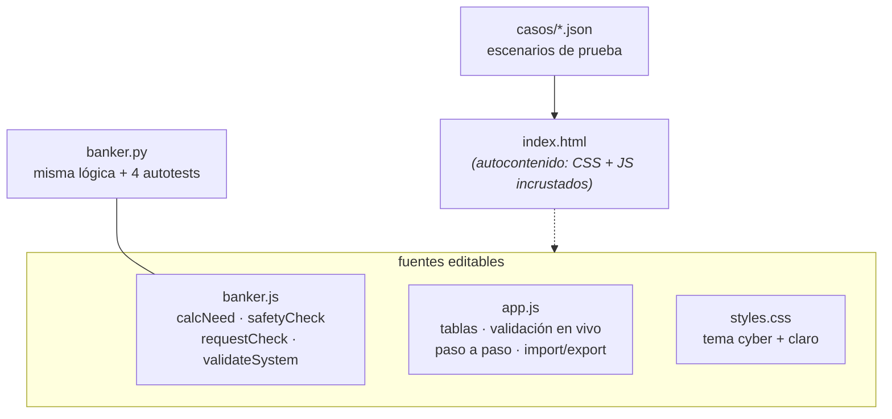

# Informe técnico — Simulador del Algoritmo del Banquero

**Universidad Mariano Gálvez de Guatemala — Facultad de Ingeniería**
**Curso:** Sistemas Operativos · **Proyecto:** Simulador del Algoritmo del Banquero
**Entrega:** código fuente + informe + defensa oral

---

## 1. Introducción

El interbloqueo (*deadlock*) es una condición donde un conjunto de procesos queda bloqueado porque cada uno retiene recursos que los demás necesitan. El **Algoritmo del Banquero**, propuesto por Edsger Dijkstra, es el esquema clásico de **evitación de interbloqueos**: el sistema solo concede recursos si existe garantía de poder atender a todos los procesos en el peor caso.

Este proyecto implementa el algoritmo completo —ingreso de datos, cálculo de Need, safety algorithm, determinación de estado y simulación de solicitudes— en una aplicación web autocontenida, con una versión de consola equivalente y pruebas automatizadas.

## 2. Objetivos

- Implementar el **safety algorithm** con las estructuras formales: `Available`, `Max`, `Allocation`, `Need`, `Work` y `Finish`.
- Determinar el **estado del sistema** (seguro / inseguro) y generar la **secuencia segura** de ejecución cuando existe.
- Permitir simular **solicitudes de recursos** aplicando el criterio de concesión tentativa del banquero.
- Validar el ingreso de datos según las reglas del enunciado (enteros ≥ 0, `Allocation ≤ Max`).
- Presentar los resultados de forma didáctica, incluyendo el detalle **paso a paso** de cada evaluación.

## 3. Marco teórico

### 3.1 Estructuras de datos (N procesos, M tipos de recurso)

| Estructura | Dimensión | Significado |
|---|---|---|
| `Available` | 1 × M | instancias libres de cada recurso |
| `Max` | N × M | demanda máxima total de cada proceso |
| `Allocation` | N × M | asignaciones vigentes |
| `Need` | N × M | `Need = Max − Allocation` — cuánto le queda por poder pedir |
| `Work` | 1 × M | vector de trabajo; inicia como copia de `Available` |
| `Finish` | 1 × N | bandera: el proceso ya pudo “completarse” en la simulación |

### 3.2 Algoritmo de seguridad

1. `Work ← Available`, `Finish[i] ← false` para todo i.
2. Buscar un `i` con `Finish[i] = false` y `Need[i] ≤ Work`.
3. Si existe, el proceso **puede terminar**: `Work ← Work + Allocation[i]`, `Finish[i] ← true`, registrar `i` en la secuencia; volver al paso 2.
4. Si en una vuelta completa ningún proceso avanza, terminar.
5. El estado es **seguro** si y solo si todos los `Finish[i] = true`; la secuencia acumulada es una secuencia segura.

La verificación `Need[i] ≤ Work` es por componente (`leq`): un proceso solo se considera completable si por **cada** recurso su Need no supera lo disponible en Work.

### 3.3 Algoritmo de solicitud (resource-request)

Para la petición `Request` del proceso `P$pid`:

1. **Si Request > Need** → error: el proceso pide por encima de lo declarado en Max (rompería la garantía del banquero).
2. **Si Request > Available** → el proceso debe **esperar**: no hay instancias físicas.
3. **Concesión tentativa:** `Available −= Request`, `Allocation[pid] += Request`, `Need[pid] −= Request`; sobre ese estado hipotético se corre el safety algorithm.
4. Si el estado tentativo es **seguro** → la solicitud se **concede**; si es inseguro se **deniega** y el estado real queda intacto. Ese paso 4 es el corazón del algoritmo: el sistema no “regala” margen que garantizaba seguridad a los demás.

## 4. Tecnología y decisiones de diseño

| Decisión | Justificación |
|---|---|
| HTML+CSS+JS vanilla sin frameworks ni CDN | Portabilidad total: el `index.html` se abre con doble clic, sin instalar nada y sin internet. Requisito del enunciado: “forma libre, clara y validada”. |
| **HTML autocontenible** | Los estilos y scripts van incrustados en `index.html`, de modo que la entrega funciona en cualquier contexto (correo, USB, vista previa). Las versiones separadas quedan como fuente legible. |
| Lógica pura en `banker.js` separada de la vista (`app.js`) | El algoritmo vive en funciones sin DOM: se prueba con Node y se duplicó en `banker.py` (Python estándar) para el CLI. Misma firma de operaciones en ambos. |
| Python para el CLI | Cualquier Linux trae Python; permite ejecutar y automatizar verificaciones desde consola, y el binario de salida distingue seguro/inseguro. |
| Simulación (no ejecución) de procesos | El banquero no ejecuta procesos: asume el peor caso (cada proceso puede pedir todo su Need antes de liberar). Eso es exactamente lo que la simulación modela. |

## 5. Estructura del sistema



## 6. Casos de prueba

### 6.1 Caso seguro — `casos/caso_seguro.json` (clásico, Silberschatz)

N = 5, M = 3, `Available = [3,3,2]`.

| P | Allocation | Max | **Need = Max − Allocation** |
|---|---|---|---|
| P0 | 0,1,0 | 7,5,3 | 7,4,3 |
| P1 | 2,0,0 | 3,2,2 | **1,2,2** |
| P2 | 3,0,2 | 9,0,2 | 6,0,0 |
| P3 | 2,1,1 | 2,2,2 | **0,1,1** |
| P4 | 0,0,2 | 4,3,3 | 4,3,1 |

**Resultado obtenido:** ✅ estado **SEGURO**, secuencia `P1 → P3 → P4 → P0 → P2`, Work final `[10,5,7]`.

Traza verificada (la misma que dibuja la interfaz, paso a paso):

| # | Proceso | Condición | Work antes → después |
|---|---|---|---|
| 1 | P0 | espera (7,4,3 > 3,3,2) | 3,3,2 → 3,3,2 |
| 2 | **P1** | **termina** (1,2,2 ≤ 3,3,2) | 3,3,2 → **5,3,2** |
| 3 | P2 | espera (6,0,0 > 5,3,2) | 5,3,2 → 5,3,2 |
| 4 | **P3** | **termina** (0,1,1 ≤ 5,3,2) | 5,3,2 → **7,4,3** |
| 5 | **P4** | **termina** (4,3,1 ≤ 7,4,3) | 7,4,3 → **7,4,5** |
| 6 | **P0** | **termina** (7,4,3 ≤ 7,4,5) | 7,4,5 → **7,5,5** |
| 7 | **P2** | **termina** (6,0,0 ≤ 7,5,5) | 7,5,5 → **10,5,7** |

### 6.2 Caso inseguro — `casos/caso_inseguro.json`

Mismo sistema con `Available = [2,0,0]`.

**Resultado obtenido:** ⛔ estado **INSEGURO**. En la primera vuelta ningún proceso cumple `Need[i] ≤ [2,0,0]` — el más cercano es P3 con `Need = [0,1,1]`, pero ya no hay instancias de B. El bucle termina con `Work` sin cambios y los **5 procesos bloqueados** (marcados en rojo en la interfaz).

### 6.3 Caso mini — `casos/caso_mini.json` (trazable a mano)

N = 3, M = 2, `Available = [2,1]`, Need = `[[2,1],[2,1],[1,2]]`.

**Resultado obtenido:** ✅ seguro, secuencia `P0 → P1 → P2`; Work final `[6,3]`. Por sus dimensiones, se puede replicar en pizarrón en 4 líneas.

### 6.4 Solicitudes de recursos (sobre el caso seguro)

| Request | Veredicto | Fundamento |
|---|---|---|
| `P1 solicita [1,0,2]` | ✅ **concedida** | ≤ Need[P1]=[1,2,2] ✔ · ≤ Available=[3,3,2] ✔ · estado tentativo `Available=[2,3,0], Allocation[P1]=[3,0,2], Need[P1]=[0,2,0]` sigue seguro (secuencia `P1 → P3 → P4 → P0 → P2`) |
| `P0 solicita [0,5,0]` | ⛅ **error** | 5 > Need[P0][1]=4: excede su máxima demanda declarada |
| `P0 solicita [4,0,0]` | ⏳ **espera** | 4 > Available[0]=3: no hay instancias libres |

### 6.5 Validación (requerimiento del enunciado)

- **Enterоs no negativos:** acepta enteros 0–999; rechaza (marcando la celda en rojo y bloqueando la ejecución) vacíos, negativos o valores fuera de rango.
- **Allocation ≤ Max:** celda por celda, con mensaje exacto: `Allocation[P2][R1]=3 supera a Max=2`.
- **Dimensiones:** Available de M, matrices N×M; N entre 1 y 12, M entre 1 y 6.

## 7. Verificación automatizada

```text
$ python3 banker.py --test
Todos los autotests PASARON (4/4).
```

Cobertura: (1) el caso seguro produce exactamente la secuencia `[1,3,4,0,2]`; (2) el caso inseguro se detecta como tal; (3) una concesión válida produce veredicto “concedida”; (4) los rechazos correctos para “excede Need” y “espera”.

## 8. Conclusiones

- El Algoritmo del Banquero, bien implementado, es **conservador por diseño**: prefiere denegar solicitudes físicamente pagables a arriesgar el sistema — la simulación mostró ese criterio en los casos 6.4.
- La diferencia entre **seguro** e **inseguro** no depende de cuántos recursos existan en total, sino de si **existe un orden de ejecución**: el experimento 6.1 vs 6.2 usa el mismo sistema (misma Allocation/Max) y solo varía Available en 1 instancia de dos recursos.
- Separar la **lógica pura** (js/py) de la vista permitió verificar el algoritmo en dos entornos independientes y con autotests, además de hacer la narración del algoritmo reproducible en clase con casos de dimensiones pequeñas.

## Anexo A — Compilación del entorno

```bash
# Web
navegador + index.html (doble clic)
# CLI
python3 --version            # 3.8+
python3 banker.py --test     # verificación
# Lógica pura (Node opcional, para pruebas eigenen)
node --check banker.js
node -e "console.log(require('./banker.js').safetyCheck([2,1],[[0,0],[0,0]], [[1,0],[0,1]]) )"
```

## Anexo B — Rúbrica del proyecto (auto-evaluación)

| # | Criterio (puntos) | Evidencia |
|---|---|---|
| 1 | Ingreso + validación (2) | Bloque 1–2 de la interfaz, validación en vivo §6.5 |
| 2 | Cálculo de Need (1.5) | Cálculo automático, tabla en interfaz, §3.1 |
| 3 | Safety algorithm (3) | `safetyCheck` con Work/Finish/leq — §3.2 y 6.1 |
| 4 | Estado seguro/inseguro (1.5) | 6.1 y 6.2, indicador de estado |
| 5 | Secuencia segura (2) | 6.1; modo step-by-step con resaltado |
| 6 | Calidad del código (1.5) | Núcleo puro + vista separada, comentarios, errores claros |
| 7 | Informe + casos (1) | Este documento |
| 8 | Defensa (2.5) | `caso_mini.json` + modo paso a paso interactivos |
