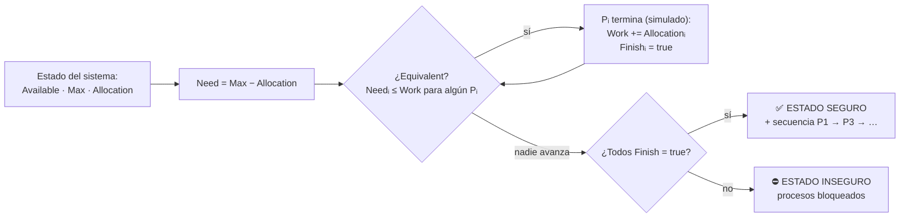

<div align="center">

# ⚿ SIMULADOR DEL ALGORITMO DEL BANQUERO

**Detección de estado seguro, secuencias de ejecución y prevención de interbloqueos**

Universidad Mariano Gálvez de Guatemala · Sistemas Operativos

   

*Interfaz web 100% autocontenida — se abre con doble clic, sin instalar nada — más CLI en Python.*

</div>

---

## ¿Qué hace?

> El **Algoritmo del Banquero** responde una pregunta: *dado lo que cada proceso podría llegar a pedir (Need = Max − Allocation) y lo que queda libre (Available), ¿existe un orden en el que **todos** los procesos puedan terminar sin caer en interbloqueo?*
>
> Este simulador responde esa pregunta en vivo: corre el **safety algorithm**, muestra la **secuencia segura** y deja simular si conceder una **nueva solicitud de recursos** mantiene al sistema a salvo.



## Características

| | |
|---|---|
| 🔍 **Algoritmo de seguridad** | `Work`, `Finish`, verificación de `Need ≤ Work` por recurso, determinación exacta de estado seguro/inseguro. |
| 🪜 **Paso a paso interactivo** | Botón *Siguiente paso* evalúa un proceso por clic, resalta su fila y muestra cómo crece `Work`. |
| 🚦 **Semáforo en la matriz Need** | Cada celda queda **verde** si cumplía la condición al evaluarse ese proceso, **roja** si desde ahí no podía terminar. |
| ✋ **Simulador de Request** | Las 3 reglas del libro: Request ≤ Need, Request ≤ Available, y concesión *tentativa* verificada con el mismo algoritmo — si dejaría el sistema inseguro, se **deniega y se descarta**. |
| 🧪 **Validación en vivo** | Sin negativos, `Allocation ≤ Max`, errores por celda con proceso y recurso exactos. |
| 📁 **Escenarios** | Casos precargados, guardar/cargar JSON (o arrastrar el archivo a la página), y **autoguardado** de la última sesión. |
| 📋 **Copiar análisis** | Reporte completo en texto (matrices, secuencia, Work y pasos) al portapapeles, listo para el informe. |
| 🌓 **Modo cyber / claro** | Estética terminal cyberpunk con transición suave, o modo claro sobrio. Preferencia recordada. |

## Archivos

| Archivo | Rol |
|---|---|
| `index.html` | Aplicación completa **autocontenida** (HTML + CSS + JS incrustados). Doble clic y funciona, incluso offline. |
| `banker.js` | **Lógica pura** del núcleo: `calcNeed`, `safetyCheck`, `requestCheck`, `validateSystem`. Sin DOM, testeable. |
| `app.js` | Capa de vista: tablas dinámicas, validación en vivo, paso a paso, import/export. |
| `styles.css` | Hoja de estilos fuente (tema cyber + modo claro). |
| `banker.py` | CLI equivalente con la misma lógica y **4 autotests**. |
| `casos/*.json` | Escenarios de prueba: clásico seguro, inseguro y 3×2 trazable a mano. |
| `MANUAL_USUARIO.md` | Manual de uso paso a paso. |
| `INFORME.md` | Informe técnico formal (objetivos, marco teórico, diseño, casos de prueba). |
| `DOCUMENTACION.md` | Referencia técnica: arquitectura, funciones, formatos y convenciones. |

> `index.html` lleva el CSS y el JS incrustados para poder abrirse sin servidor.
> Las versiones fuente (`banker.js`, `app.js`, `styles.css`) son la base editable;
> si se modifica alguna, se copia de nuevo dentro de `index.html`. `banker.py` es independiente.

## Uso rápido

**Web (recomendado):** abre `index.html` con doble clic. No requiere servidor, internet ni instalación.

```bash
# También disponible por servidor local
python3 -m http.server 8000    # → http://localhost:8000

# CLI para consola y verificación
python3 banker.py --ejemplo seguro
python3 banker.py --ejemplo inseguro
python3 banker.py --archivo casos/caso_seguro.json --request 1:1,0,2
python3 banker.py --test
```

## Casos de referencia

| Caso | Available | Resultado |
|---|---|---|
| `caso_seguro.json` — clásico (Silberschatz) | `[3,3,2]` | ✅ **SEGURO** · secuencia `P1 → P3 → P4 → P0 → P2` · Work final `[10,5,7]` |
| `caso_inseguro.json` — mismo sistema | `[2,0,0]` | ⛔ **INSEGURO** · nadie cumple `Need ≤ Work` · los 5 procesos quedan bloqueados |
| `caso_mini.json` | `[2,1]` | ✅ **SEGURO** · `P0 → P1 → P2` · ideal para trazar a mano en la defensa |

Solicitudes de ejemplo sobre el caso seguro:

| Request | Veredicto | Por qué |
|---|---|---|
| `P1 pide [1,0,2]` | ✅ **concedida** | ≤ Need y ≤ Available, y el estado tentativo sigue seguro |
| `P0 pide [0,5,0]` | ⛔ **error** | 5 > 4: excede su propia Need declarada |
| `P0 pide [4,0,0]` | ⏳ **espera** | pide 4 de A con solo 3 disponibles |

## Pruebas

```bash
python3 banker.py --test
```

4 aserciones automatizadas: el caso seguro produce la secuencia exacta `[1,3,4,0,2]`, el caso inseguro no encuentra secuencia, y los tres veredictos de Request (concedida, excede Need, espera).

## Licencia

[MIT](LICENSE)
